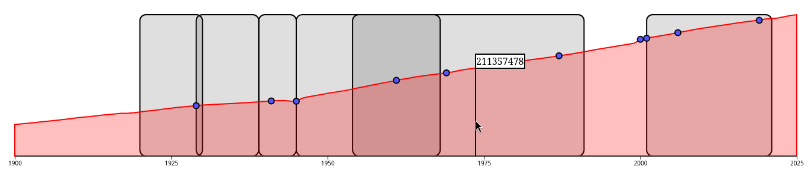

This assignment shows a small timeline of U.S. history. The red area representes
the population, the blue circles are each significant events, and the
translucent rectangles represent eras during the history. Hovering over the
rectangles, red area, or blue circles.

The site can be accessed at
[https://simirian.github.io/a1-ghd3](https://simirian.github.io/a1-ghd3).

# Requirements

1. Your project should contain at least four kinds of graphics primitives
   (circles, rectangles, lines, polygons) in different colors. 
    - circles are the blue event dots
    - rectangles are the translucent era markers and the tooltip
    - lines are the axis line and the vertical population marker
    - polygon is the population area
2. Your document should identify the sources of the code if you start with code
   that you found. 
    - everything was written by hand using d3's
      [tooltip](https://d3-graph-gallery.com/graph/interactivity_tooltip.html)
      and [area chart](https://observablehq.com/@d3/area-chart/2) examples as
      reference
3. Your code should be forked from the GitHub repo and published with GitHub
   Pages. See the "GitHub Details" section below for detailed instructions on
   how to do this.
    - it is :)

# Technical Achievement

I made an actual visualization, which is already beyond the requirements. The
main interesting technical things that I did were the tooltip which follows the
cursor when hovering the era blocks and the event dots, and creating the
vertical population marker. I also made it so that you can click the eras and
events to open Wikipedia pages about them.

# Design Achievement

Again, actual data visualization. I grabbed a real data set and added multiple
addiitonal pieces of information to the graph. Every piece of information is
distinct and valuable, and while I didn't include every event and era possible,
I loaded them from JSON which couldbe extended with more events and eras easily.
